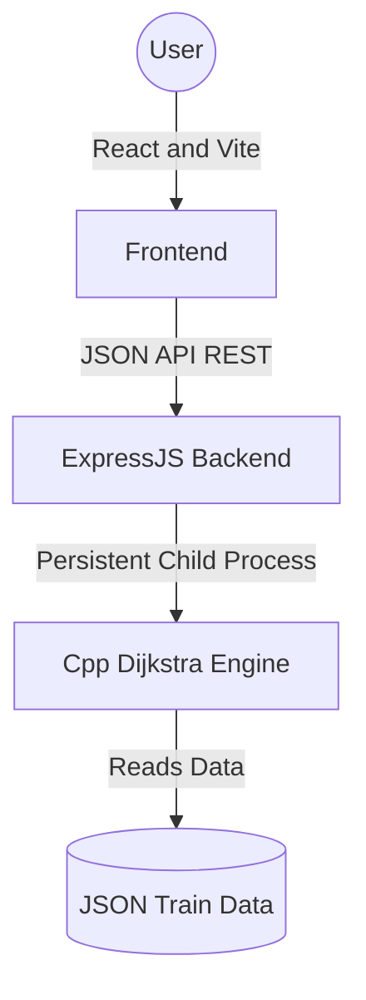

# RailYatra

**RailYatra** is a high-performance train route-finding platform. It features a custom-built C++ navigation engine capable of processing thousands of train schedules to find the most optimal multi-leg journeys across the Indian Railways network.

---

- **Station Search**: Fuzzy-matching autocomplete with keyboard navigation and typo-tolerance.
- **Train Collections**: Visual route charts for special train categories like Vande Bharat, Tejas, and Gatiman.
- **Modular Data System**: Add new train categories by dropping in JSON data files.

---

## Key Features

- **Fast C++ Engine**: Layered multi-pass Dijkstra written in C++17, finding routes in under 10ms.
- **City-Level Routing**: Multi-source, multi-destination routing — search between entire cities (e.g., "Mumbai" to "Delhi"), all station combinations explored simultaneously.
- **Route Charts**: Modular chart system for special train categories with serial numbers and detailed timings.
- **Multi-Criteria Sort**: Sort routes by travel time, total distance, or minimum switches.
- **Progressive Loading**: Fetches up to 50 routes in a single engine call, displayed 10 at a time with a "Load More" button.
- **Transfer Validation**: Validates connecting times at junctions (minimum 30 min buffer, max wait limit configurable).
- **Station Search**: Fuse.js-powered typo-tolerant autocomplete with keyboard navigation and live match highlighting.
- **Modern UI**: React 19 frontend with glassmorphism, animations, and responsive design.

---

## Dijkstra Logic

The core navigation engine implements a **Layered Multi-Pass Dijkstra** optimized for scheduled transportation networks. See [`docs/logic.md`](docs/logic.md) for the full technical breakdown.

### 1. Layered Pass Strategy
The engine runs one independent Dijkstra pass per transfer level (0 → 1 → 2 → … up to `maxSwitches`), stopping as soon as 10 results are collected:
- **Pass 0**: Direct routes only (0 transfers) — ranked by total travel time.
- **Pass 1**: Routes with 1 transfer — fills remaining slots, also ranked by time.
- **Pass N**: Continues until 10 unique routes are found.

This guarantees direct routes always come before 1-transfer routes in the output, regardless of cost.

### 2. Destination-Exempt Pruning
The `bestCost[station][switches]` table prunes redundant intermediate paths. Critically, the **destination station is exempt** from this pruning — every train that reaches the destination is evaluated, allowing multiple direct trains to the same endpoint to all appear in results.

### 3. Real-World Constraints
During expansion, every potential connection is validated for:
- **Chronological Validity**: Departing train must leave *after* the previous train arrives.
- **Transfer Window**: Wait time ≥ 30 min and ≤ `max_wait` (default: 10 hours, capped at 20).
- **Switch Budget**: Prunes branches exceeding the per-pass `maxSwitches` cap.

---

## Data

All timetable files are generated and validated by the data pipeline in [`datapipe/`](datapipe/README.md); a weekly GitHub Actions job rebuilds them and opens a reviewable PR when data changes. Do not edit the JSON files by hand (CI checks this).

## Architecture

A modular monolith with feature modules, shared platform ports and a single composition root. See [`docs/ARCHITECTURE.md`](docs/ARCHITECTURE.md) for the rules, how to add a feature, lifecycle and configuration.

## Scalability & Operations

See [`docs/SCALING_ROADMAP.md`](docs/SCALING_ROADMAP.md) for the audit, capacity model, phased plan and load-test results.

- **Engine pool**: `ENGINE_POOL_SIZE` engine processes (default: CPU cores), least-loaded dispatch, crash isolation and auto-respawn.
- **Caching**: in-process LRU with request coalescing for routes (keyed by weekday), schedules and autocomplete; CDN-friendly `Cache-Control` headers.
- **Endpoints**: `/healthz` (liveness), `/readyz` (readiness), `/metrics` (Prometheus).
- **Tests**: `cd backend && npm test` (requires a built engine). CI (`.github/workflows/ci.yml`) also runs a frontend typecheck/build, a load-test gate and a Docker smoke test.
- **API**: route search is available as `GET /api/route?from=&to=&date=…` (CDN-cacheable; used by the frontend) and as `POST /api/route` with a JSON body.
- **Logs**: set `LOG_FORMAT=json` for structured one-line JSON logs.
- **Best trade-offs**: `GET /api/route/pareto?from=&to=&date=&max_switches=&max_wait=` returns, for each number of changes, the earliest possible arrival (exact; see `engine/trip_router.cpp`). Verified by `python3 engine/tests/validate_pareto.py`.
- **Timetable hot reload**: replace `master_train_data.json` and send `SIGHUP` to the server; a new engine pool is swapped in with zero downtime and caches are invalidated. Responses carry `X-Data-Version`.
- **Load tests**: `cd loadtest && npm install && node run.js mixed --url http://localhost:3000`.
- **Deploy**: `deploy/docker-compose.yml` (+ nginx edge) and `deploy/k8s/railyatra.yaml` (HPA, PDB).

| Env var | Default | Purpose |
|---|---|---|
| `ENGINE_POOL_SIZE` | CPU cores | Engine processes per instance |
| `ENGINE_TIMEOUT_MS` | 10000 | Per-request engine timeout |
| `ENGINE_MAX_QUEUE` | 200 | In-flight requests per engine before shedding with 503 |
| `ROUTE_CACHE_SIZE` / `ROUTE_CACHE_TTL_MS` | 50000 / 30 min | Route result cache |

---

## Architecture

The project uses a three-tier setup: a React frontend talks to an Express.js backend, which delegates pathfinding to a persistent C++ child process.



### Key Decisions
- **C++ Engine**: Routing runs in a pool of persistent, compiled C++17 processes to avoid Node.js CPU bottlenecks. Managed by `backend/src/platform/routing/enginePool.js`, behind the `RoutingPort` interface.
- **Modular monolith**: feature modules in `backend/src/modules/`, shared building blocks in `backend/src/platform/`, wired once in `backend/src/container.js`. See [`docs/ARCHITECTURE.md`](docs/ARCHITECTURE.md).
- **Express.js gateway**: HTTP pipeline in `backend/src/app.js`.
- **React 19 frontend**: Single-page app with Framer Motion animations.

### Tech Stack
- **Frontend**: React 19, TypeScript, Vite, Tailwind CSS, Framer Motion, Lucide Icons.
- **Backend**: Node.js, Express.js.
- **Engine**: C++17, `nlohmann/json` for JSON serialization.

---

## Setup & Installation

### 1. Build the Engine
Requires `g++` (MinGW-w64) installed and in your PATH.
```bash
cd engine
./build.ps1
```

### 2. Prepare Data
Ensure `master_train_data.json` and `city_stations.json` are present in the project root. The `city_stations.json` enables city-level clustered searches.

### 3. Start the Backend
```bash
cd backend
npm install
node server.js # Starts on Port 3000
```

### 4. Start the Frontend
```bash
cd frontend
npm install
npm run dev # Starts on Port 5173
```

## Project Structure

```
backend/
├── src/
│   ├── modules/           # One folder per feature (journeys, stations, schedule, ...)
│   ├── platform/          # Config, logging, metrics, cache, errors, validation, reference data, routing
│   ├── container.js       # Composition root (builds and wires dependencies)
│   └── app.js             # HTTP pipeline (security headers, metrics, error handling)
├── test/                  # Integration and architecture tests
└── server.js              # Entry point (signals, startup, shutdown)
engine/                    # C++ route engine (handlers.cpp = request types)
datapipe/                  # Timetable ingestion pipeline
stations.json, city_stations.json, master_train_data*.json   # Generated by datapipe
frontend/
├── src/                   # React components and custom hooks
├── public/                # Static assets
└── index.html
```

---

## API Reference

### `POST /api/route`
Calculates routes between two stations.
| Parameter | Type | Description | Default |
| :--- | :--- | :--- | :--- |
| `from` | `String` | Source station name or code | (Required) |
| `to` | `String` | Destination station name or code | (Required) |
| `date` | `String` | Journey date (YYYY-MM-DD) | (Required) |
| `sort_by` | `String` | `time`, `distance`, or `switches` | `switches` |
| `max_wait` | `Int` | Max wait time at transfers (minutes) | `600` (10h) |
| `max_switches`| `Int` | Max number of transfers allowed | `5` |
| `top_k` | `Int` | Number of results to return | `50` |

### `GET /api/stations`
Fuzzy-autocomplete endpoint for station search (Fuse.js). Returns top 10 matches ranked by relevance.

### `GET /api/category/:category`
Fetches trains for a specific collection (e.g., `vandebharat`, `tejas`). Returns route chart data.

### `GET /api/schedule/:trainNumber`
Fetches the full schedule for a specific train. Returns station stops, arrival/departure times, and operating days.

### `GET /api/pdf/:trainNumber`
Serves the PDF timetable for the requested train (if available).

---

## Testing & Benchmarks
The system includes a verification suite in `/tests`:
- **Correctness**: Validates that found routes actually exist in the raw JSON schedules.
- **Performance**: Measures engine latency (target: <10ms per search).
- **Integrity**: Ensures no "illegal" transfers (e.g., departing before arrival) are returned.

### Engine Throughput Benchmark
Based on local system benchmarking (Intel i5/equivalent, single-process engine):
- **Average Latency**: ~0.94 ms per route calculation.
- **Throughput**: ~1,067 requests/second.
